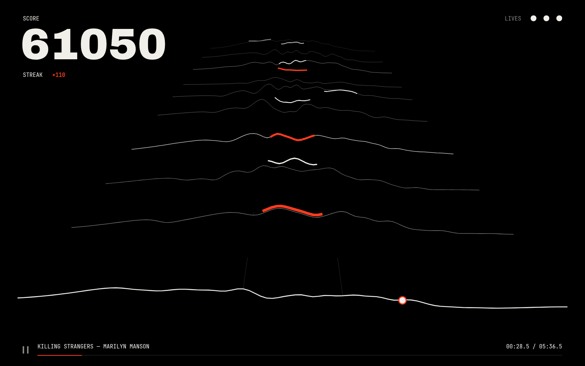

# waves



Drop in a song and ride it: an Audiosurf-like game in the browser. The track is built from the music itself: ridges are its spectrum and arrive on the beat, choruses and drops speed you up, kicks shake the field. A hit lands on every swell in the music, the strongest white to catch, the rest red to dodge. Three red hits and the song stops.

Play at [dragunovartem99.github.io/waves](https://dragunovartem99.github.io/waves). Steer with ← → or by tapping either half of the screen; Space or Esc pauses. The song never leaves your browser.

Add `?bot` and an autopilot rides for you, catching every pickup, for recording demos.

## Development

Requires Node 24+.

```sh
npm install
npm run dev          # local dev server
npm run dev:bot      # dev server opened with ?bot
npm run build        # static build into dist/
npm run preview      # serve the build
```

Checks (run by the pre-commit hook and CI):

```sh
npm run format:check
npm run types:check
npm run lint:check
npm test
```

## Deployment

Merging to `main` builds and deploys to GitHub Pages via [pipes](https://github.com/dragunovartem99/pipes).
