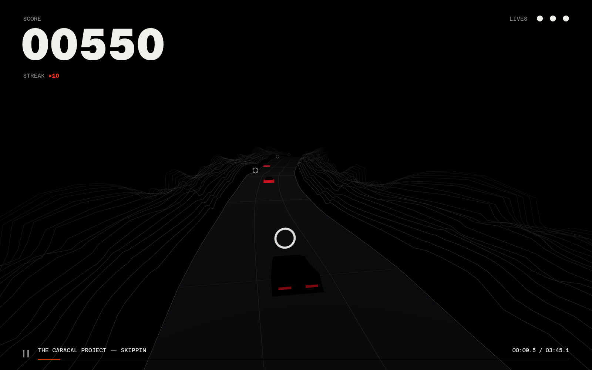

# waves



Drop in a song and ride it: an AudioSurf-like game in the browser. The track is built from the music itself: the 3D road climbs and dives with its intensity, spectral waves flank the lanes, louder passages speed you up, and kicks add a surge. Hits land on significant musical swells, the strongest white to catch, the rest red to dodge. Three red hits and the song fades into a muffled background.

Play at [dragunovartem99.github.io/waves](https://dragunovartem99.github.io/waves). Steer with ← → or by tapping either half of the screen; hold Space to slow time, Esc pauses, as does hiding the tab. The song never leaves your browser.

Add `?bot` and an autopilot rides for you, catching every pickup, for recording demos.

[AudioSurf lineage and track generation](docs/audiosurf.md) documents the current analysis pipeline, what was ported from AudioSurf, and where Waves deliberately diverges.

## Development

Requires Node 24+.

```sh
npm install
npm run dev          # local dev server
npm run dev:bot      # dev server opened with ?bot
npm run build        # static build into dist/
npm run preview      # serve the build
```

Local checks (also run by the pre-commit hook):

```sh
npm run format:check
npm run types:check
npm run lint:check
npm test
```

CI runs the same format, type, and lint checks, plus `npm run test:coverage` and `npm run build`.

## Deployment

Merging to `main` builds and deploys to GitHub Pages via [pipes](https://github.com/dragunovartem99/pipes).
